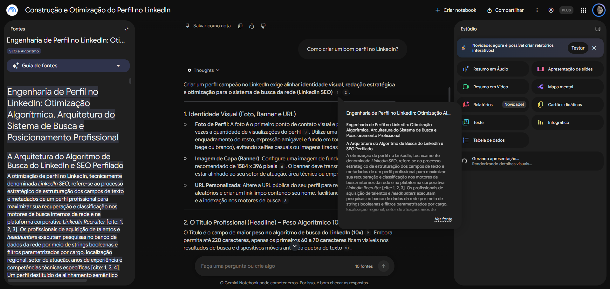
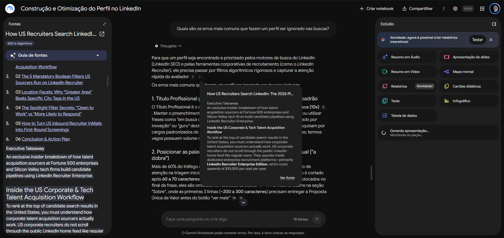
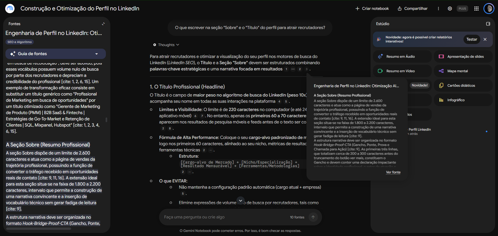

# 🧠 Segundo cérebro no Gemini Notebook sobre "Construção e Otimização do Perfil do LinkedIn" - Desafio DIO

> Projeto desenvolvido para o Desafio de Projeto da **DIO (Digital Innovation One)** com foco em IA generativa e curadoria de conteúdo no Gemini Notebook.

---

## 🎯 Tema e Objetivo

Criar um especialista para me guiar na construção de um perfil bom e otimizado no LinkedIn, atraindo mais recrutadores e oportunidades.

*(Sobre a escolha: Além de cumprir os requisitos do desafio prático, a motivação deste projeto é aprender e aplicar diretamente melhorias reais no meu próprio perfil profissional, utilizando fontes confiáveis e validadas pelo mercado)*

---

## 🔗 Link do Gemini Notebook

Acesse o segundo cérebro criado no Gemini Notebook:
👉 **https://notebook.google.com/notebook/1282624b-b41a-4dab-8ed4-bc5bbc4ce82a**

---

## 📚 Fontes Selecionadas e Justificativa de Confiança

As fontes foram criteriosamente filtradas para evitar repetições desnecessárias e garantir autoridade oficial e prática:

1. **Criar um bom perfil do LinkedIn (https://www.linkedin.com/help/linkedin/answer/a554351/como-posso-criar-um-bom-perfil-do-linkedin-?lang=pt):**  
   *Por que confio:* É a fonte primária oficial da própria plataforma com as regras e diretrizes recomendadas.
   
2. **How US Recruiters Search LinkedIn: The 2026 Playbook (https://linkedinrank.com/blogs/how-us-recruiters-search-linkedin):**  
   *Por que confio:* Traz a ótica de quem contrata (recrutadores), explicando como funcionam os filtros de busca e algoritmos.
   
3. **Guia de Títulos do LinkedIn (https://www.linkedhelper.com/pt/blog/linkedin-headline-examples):**  
   *Por que confio:* Traz fórmulas e exemplos práticos para criação de títulos com palavras-chave estratégicas.
   
4. **Social Selling Index: Complete Guide (https://www.ambassify.com/blog/social-selling-index):**  
   *Por que confio:* Explica a métrica do próprio LinkedIn que pontua o nível de autoridade e engajamento da conta.
   
5. **LinkedIn Character Limit by Category (https://www.linkedhelper.com/blog/linkedin-character-limit):**  
   *Por que confio:* Referência técnica dos limites atuais de caracteres para cada campo do perfil.

6. **Relatório do Deep Research: Engenharia de Perfil no LinkedIn:**  
   *Por que confio:* Fornece uma visão aprofundada, estruturada e analítica sobre posicionamento e arquitetura do perfil.

7. **YouTube: "LinkedIn 2026: Como Montar um Perfil Poderoso e Atrair Oportunidades" (https://www.youtube.com/watch?v=rH_k0HX1SHs)**
   *Por que confio:* Diversos relatos de pessoas mostrando resultados positivos após seguir o que foi dito no vídeo.

8. **8 Exemplos de Modelos de Perfil do LinkedIn para 2026 (https://redactai.io/pt/blog/8-exemplos-de-modelos-de-perfil-do-linkedin-para-2026)**
   *Por que confio:* Traz modelos práticos e atualizados para o cenário de 2026, com foco em inteligência artificial.

9. **Como criar um perfil no LinkedIn e chamar a atenção das empresas? (https://www.unicesumar.edu.br/blog/como-criar-um-perfil-no-linkedin-e-chamar-a-atencao-das-empresas/)**
   *Por que confio:* Confio nesta fonte por ser produzida pelo portal de carreiras de uma grande instituição de ensino superior reconhecida.

---

## ⚙️ Diretriz de Comportamento (Prompt do Sistema)

A diretriz atribuída ao assistente foi:

> *"Comporte-se como um especialista em construção e otimização de perfis do LinkedIn."*

---

## 💬 Perguntas Realizadas e Respostas com Citações

Para validar que o assistente responde estritamente com base nos documentos carregados (comprovado através dos identificadores de citação), foram realizados os seguintes testes no chat:

### 1. Como criar um bom perfil no LinkedIn?
- **Resumo da Resposta:** O assistente destacou que a criação de um perfil de alto impacto depende de técnicas de *LinkedIn SEO* (otimização para motores de busca). Ele explicou que o perfil precisa ser estruturado nos campos de texto e metadados para responder aos filtros parametrizados e buscas booleanas do *LinkedIn Recruiter*, alertando que a falta de alinhamento semântico derruba em mais de 95% os cliques no perfil.
- **Fonte Citada:** *Relatório do Deep Research: Engenharia de Perfil no LinkedIn (Seção: A Arquitetura do Algoritmo de Busca do LinkedIn e SEO Perfilado)*.

### 2. O que escrever na seção "Sobre" e no "Título" para atrair recrutadores?
- **Resumo da Resposta:** Orientou que o Título e o Resumo (Sobre) são os campos mais indexados pelo algoritmo. Devem conter termos e palavras-chave alinhados exatamente com o que headhunters pesquisam (cargos, especialidades e competências técnicas), evitando descrições genéricas que não respondem aos filtros de busca.
- **Fonte Citada:** *Relatório do Deep Research: Engenharia de Perfil no LinkedIn (Seção: A Arquitetura do Algoritmo de Busca do LinkedIn e SEO Perfilado)*.

### 3. Quais são os erros mais comuns que fazem um perfil ser ignorado nas buscas?
- **Resumo da Resposta:** O principal erro apontado é a ausência de alinhamento semântico com os termos buscados pelos recrutadores, o que empurra o perfil para as páginas secundárias de busca. Outros erros incluem não utilizar palavras-chave nos campos estratégicos e não configurar metadados de competências exigidos pelo *LinkedIn Recruiter*.
- **Fonte Citada:** *Relatório do Deep Research: Engenharia de Perfil no LinkedIn (Seção: A Arquitetura do Algoritmo de Busca do LinkedIn e SEO Perfilado)*.

---

## 📸 Evidências do Chat (Citações das Fontes)

---

## 📦 Materiais Gerados no Estúdio

No painel do Gemini Notebook foram gerados materiais complementares para estudo:
- **Apresentação de Slides:** Disponível para download nos arquivos deste repositório.
